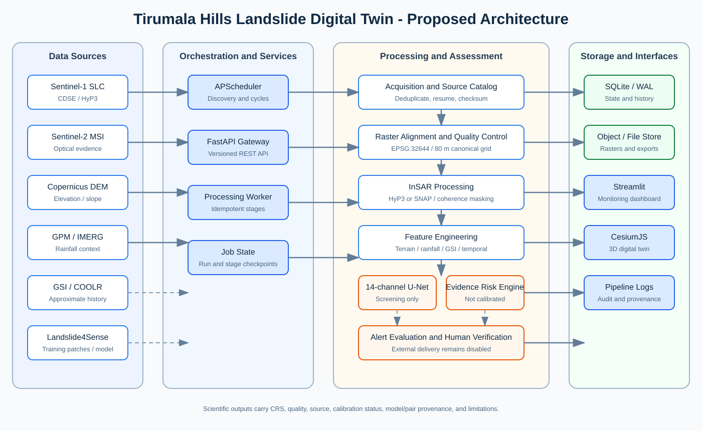
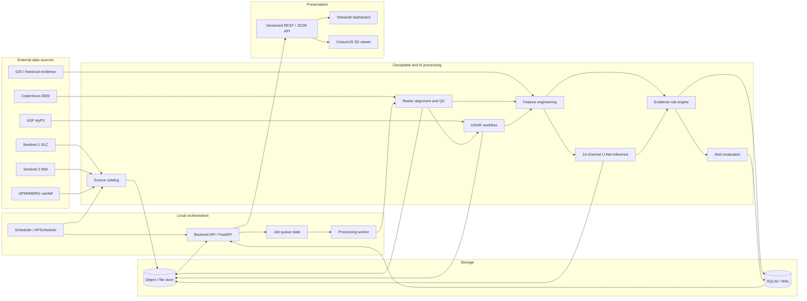

# Proposed System Architecture
## Tirumala Hills Landslide Digital Twin

**Document status:** Proposed target architecture
**Study area:** Tirumala Hills, Tirupati District, Andhra Pradesh
**Processing grid:** EPSG:32644, 80 m, 110 x 69 cells
**Scientific status:** Research prototype; not a validated operational early-warning system

## 1. Architectural Goals

The proposed architecture separates acquisition, processing, assessment,
storage, presentation, and audit concerns while preserving the project's local
and low-cost operating model.

1. Produce reproducible, georeferenced evidence on a stable spatial grid.
2. Prevent unsupported scientific claims by carrying quality and calibration
   metadata through every pipeline stage.
3. Separate static research artifacts from live monitoring state.
4. Support a laptop deployment while allowing individual services to move to
   Azure or another managed environment later.
5. Keep all ingestion, processing, and risk updates resumable and auditable.
6. Require human verification before external alerts are sent.

## 2. Target Architecture

[](./proposed_architecture_diagram.svg)



## 3. Component Responsibilities

| Component | Proposed responsibility | Existing implementation |
|---|---|---|
| Acquisition catalog | Search, deduplicate, resume, checksum, and track source products | `src/data/catalog.py`, CDSE/IMERG scripts |
| Scheduler | Trigger discovery and downstream jobs with bounded retries | APScheduler in `automation/scheduler.py` |
| Processing worker | Execute one idempotent pipeline run and isolate failures by stage | `automation/pipeline.py` and scripts |
| Raster preprocessing | Align all layers to EPSG:32644 and an 80 m canonical grid | `src/features/align_terrain_to_insar.py`, clip and feature scripts |
| InSAR workflow | Submit or run pair processing, validate quality, and preserve pair metadata | HyP3 integration and `src/preprocessing/insar_pipeline.py` |
| Feature engineering | Compute terrain, rainfall, GSI proximity, coherence, and temporal features | `src/environmental`, `src/features`, and `src/risk_assessment.py` |
| U-Net service | Run Landslide4Sense-compatible 14-channel patch inference and preserve model provenance | `src/models/landslide_segmentation.py` |
| Risk engine | Produce relative evidence scores with missing-factor coverage disclosed | `src/risk_assessment.py`, `src/features/risk_engine.py` |
| Alert engine | Evaluate transparent rules and create pending, reviewable alerts | `src/agent/alert_engine.py` |
| SQLite data layer | Store catalogs, observations, risk history, alerts, logs, and configuration | `src/data/db.py`, `database/schema.sql` |
| Backend API | Provide read/write service contracts and decouple the viewers from the database | Proposed; use the existing integration module initially |
| Streamlit dashboard | Summaries, evidence tables, rainfall, model output, and controls | `dashboard/app.py` |
| CesiumJS viewer | 3D terrain, evidence meshes, vector layers, timeline, and cell inspection | `viewer/cesium/` |

## 4. Processing Pipeline

Each monitoring cycle should execute the following stages:

1. **Discover**
   - Query product sources.
   - Store discovery evidence and deduplicate by source product identifier.
2. **Acquire**
   - Download atomically.
   - Verify checksums and file completeness.
   - Resume interrupted downloads.
3. **Validate**
   - Verify CRS, resolution, bounds, nodata values, and file integrity.
   - Reject or quarantine mismatched products.
4. **Preprocess**
   - Align raster products to the canonical EPSG:32644 80 m grid.
   - Derive slope and related terrain features without modifying source rasters.
5. **Process**
   - Generate or retrieve InSAR pair products.
   - Apply coherence and nodata quality masks.
   - Preserve pair-specific phase reference metadata.
6. **Analyze**
   - Reconcile rainfall windows only from complete calendar periods.
   - Run U-Net inference only on explicitly compatible HDF5 patches.
   - Calculate relative evidence scores.
7. **Publish**
   - Write an immutable observation snapshot and aggregate risk history.
   - Export reviewed dashboard and Cesium manifests.
8. **Evaluate**
   - Create alerts as pending records.
   - Require human verification and an explicit delivery decision.

Every stage should use a unique run ID and write start time, end time, status,
retry count, input identifiers, output identifiers, version, and errors to
`pipeline_logs`.

## 5. API Design

FastAPI is the proposed service boundary for the next implementation phase.
The existing read-only backend functions can become adapters rather than being
reimplemented.

| Endpoint | Method | Purpose |
|---|---|---|
| `/api/v1/status` | GET | Data freshness and pipeline health |
| `/api/v1/acquisitions` | GET | Acquisition history |
| `/api/v1/insar/pairs` | GET | Pair metadata and scientific status |
| `/api/v1/risk/current` | GET | Current evidence score and distribution |
| `/api/v1/risk/history` | GET | Historical aggregate records |
| `/api/v1/risk/cells/{cell_id}` | GET | Cell evidence and limitations |
| `/api/v1/rainfall` | GET | Reconciled rainfall context |
| `/api/v1/alerts` | GET | Evaluated and persisted alerts |
| `/api/v1/pipeline/runs/{run_id}` | GET | Stage status and diagnostics |
| `/api/v1/pipeline/runs` | POST | Start a bounded, approved pipeline run |
| `/api/v1/alerts/{alert_id}/verification` | POST | Human verification result |

The API should be versioned, read-only by default for frontends, and backed by
the SQLite repository. It should emit structured JSON and never infer a
cumulative velocity or calibrated probability.

## 6. Storage Layout

```text
data/
  raw/             Source products and training patches
  processed/       Canonical raster products
  features/        Cell and temporal feature tables
models/            Versioned model checkpoints and metadata
database/
  monitoring.db    Operational state
  schema.sql       Schema definition
  backups/         Timestamped database backups
outputs/
  reports/         Run reports
  backend/         Backend integration exports
viewer/cesium/
  models/          DEM-derived GLB meshes
  textures/        Georeferenced evidence textures
  data/            Viewer manifests and inspection data
logs/
  pipeline_status.json
```

Source rasters and exported viewer assets are separated from database state.
Large source products remain in a local object-store-like directory. A future
managed object store should use the same stable logical IDs and checksums.

## 7. Scientific and Quality Guardrails

The architecture must preserve the following limitations:

- InSAR LOS displacement is pair-specific unless phase references and
  processing bases are proven compatible.
- No pair-to-pair displacement subtraction is exposed when references differ.
- A missing factor is excluded from the available-weight denominator rather
  than treated as zero.
- Rainfall is study-area context, not a per-cell precipitation measurement.
- GSI and COOLR locations are historical evidence with positional uncertainty.
- U-Net outputs are screening indicators and have no Tirumala-specific
  calibration.
- Risk classes are empirical evidence categories, not calibrated probabilities.
- Alerts require human verification and must not be labeled confirmed warnings.

Required metadata in every scientific output:

- source identifier and acquisition date
- processing workflow and software version
- CRS and grid resolution
- quality mask and valid-cell count
- phase reference or model checkpoint identifier
- calibration status
- provenance and explicit limitations

## 8. Security and Operations

- Store CDSE, Earthdata, HyP3, notification, and Azure credentials in `.env`
  or a managed secret store; never commit them.
- Restrict the processing worker to minimum necessary filesystem and network
  access.
- Keep external notification delivery disabled until credentials, templates,
  and human verification are configured.
- Back up SQLite before migrations and retain timestamped database backups.
- Validate uploaded HDF5 patches for shape `(128, 128, 14)`, finite values,
  and file size before inference.
- Log failures without storing credentials or raw secret-bearing responses.
- Use TLS for any network-accessible API deployment.

## 9. Deployment Profiles

### Laptop research profile

- One Python environment
- Streamlit on local port
- CesiumJS served locally
- APScheduler in a separate process
- SQLite WAL database
- Local file-store structure
- CPU-only U-Net inference
- Optional HyP3 cloud processing

### Service-oriented local profile

- Streamlit frontend
- FastAPI backend
- Dedicated worker process
- SQLite repository
- Local HTTPS reverse proxy
- Same geospatial and model modules

### Managed Azure profile

- App Service or Container Apps for the API and dashboard
- Azure Functions or Container Apps Jobs for scheduled discovery
- Azure Blob Storage for source products and exports
- Azure SQL or PostgreSQL only if concurrent multi-user access is required
- Application Insights for pipeline telemetry
- Key Vault for credentials
- Managed notification delivery and human-verification workflow

SQLite should remain the laptop profile's storage engine. Moving to Azure does
not require replacing the domain modules or geospatial contract.

## 10. Implementation Priority

### Phase A: Stabilize the service boundary

1. Add FastAPI around `src/backend_integration.py`.
2. Add Pydantic response schemas and API tests.
3. Make dashboard and Cesium reads consume API JSON instead of direct
   implementation assumptions.

### Phase B: Complete reliable orchestration

1. Replace file-spread pipeline calls with an explicit DAG or job runner.
2. Use idempotency keys for acquisitions, pairs, observations, alerts, and runs.
3. Add retries with exponential backoff and stage-level checkpoints.
4. Run live authenticated ingestion as a monitored validation, not a demo.

### Phase C: Improve temporal scientific validity

1. Use compatible InSAR pairs with documented phase references.
2. Replace pair-specific differences only after a validated analysis design.
3. Add uncertainty, confidence, and quality fields to the observation contract.

### Phase D: Operationalize safely

1. Validate notifications externally.
2. Add human verification and audit history.
3. Add database backups and restore tests.
4. Publish health, freshness, and provenance in the dashboard.

## 11. Acceptance Criteria

The target architecture is complete when:

- A monitoring run can be replayed from source identifiers and configuration.
- Interrupted runs resume without duplicating acquisitions or observations.
- Raster alignment is validated before downstream processing.
- Pair-specific and model-specific metadata reach the API and dashboard.
- Missing evidence is represented explicitly.
- No calibrated-risk or confirmed-warning language is generated by the code.
- Database writes are transactional and idempotent.
- External alerts remain blocked until verified and configured.
- Tests cover API contracts, raster alignment, reruns, quality masks, alert
  evaluation, and database migrations.
