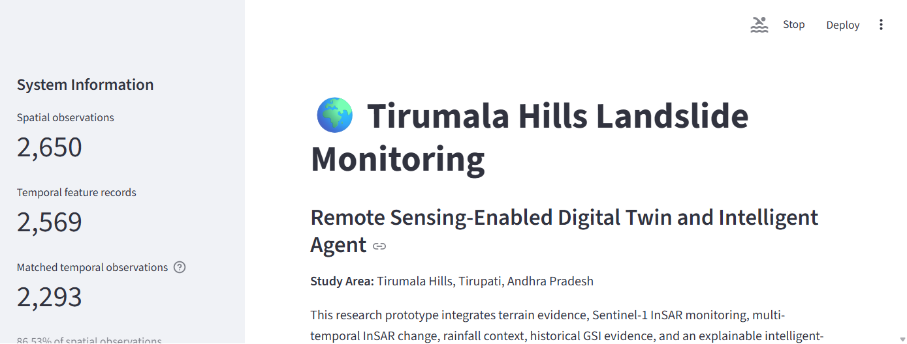

# Tirumala Hills Landslide Digital Twin

Research prototype for remote-sensing-based landslide monitoring in Tirumala
Hills, Tirupati, Andhra Pradesh. The project integrates terrain, Sentinel-1
InSAR, rainfall context, approximate historical GSI locations, a rule-based
Intelligent Agent, and an HDF5-based U-Net segmentation demonstration.

This is a research and demonstration application. It is **not** a validated
landslide-prediction service or an operational early-warning system.

## 1. Problem statement and objectives

Landslide monitoring benefits from combining multiple observations while
making uncertainty and data gaps explicit. This project demonstrates how
terrain, radar line-of-sight (LOS) measurements, rainfall context, and
historical landslide evidence can be presented together for the Tirumala Hills
study area.

Objectives:

- Prepare spatial and temporal evidence tables from existing remote-sensing
  and reference datasets.
- Display the evidence in a 2D GIS-based Digital Twin and Streamlit dashboard.
- Apply transparent, rule-based evidence categories and monitoring prompts.
- Demonstrate a separately trained Landslide4Sense U-Net on compatible HDF5
  patches, without implying Tirumala-specific validation.
- Document evidence limitations rather than treating screening indicators as
  calibrated probabilities.

## 2. Canonical application and project layout

The canonical Tirumala dashboard is [`dashboard/app.py`](./dashboard/app.py).
Do not use the root-level `app.py` or `src/dashboard/app.py` for the Tirumala
demonstration: those are duplicate/older applications, and
`src/dashboard/app.py` is for the separate Moghalrajpuram, Vijayawada study.

Important project directories:

| Path | Purpose |
|---|---|
| `dashboard/` | Canonical Tirumala Streamlit application |
| `data/raw/` | Source datasets, including Landslide4Sense training patches |
| `data/processed/` | Prepared terrain, InSAR, and rainfall data |
| `data/features/` | Spatial, temporal, GSI, and agent feature tables |
| `models/` | Saved model checkpoints |
| `outputs/` | Assessment tables, diagnostics, and inference reports |
| `results/digital_twin/` | 2D HTML map and InSAR overlay image |
| `results/eda/`, `results/summary/` | Existing research figures and summaries |
| `scripts/`, `src/`, `notebooks/` | Processing, analysis, training, and evaluation code |

The original HyP3 pair products were inspected under
`C:\S1\HyP3\Tirumala\extracted` and are not necessarily portable with this
repository.

## 3. System architecture

```text
Sentinel-1 HyP3 products ──┐
DEM and derived slope ─────┼─> prepared rasters / feature tables ─┐
GSI map-derived locations ─┤                                      ├─> rules-based
GPM/IMERG rainfall ────────┘                                      │   evidence tables
                                                                  │
Landslide4Sense HDF5 patches ─> PyTorch 14-channel U-Net ─────────┤
                                                                  v
                                                     Streamlit dashboard
                                                                  │
                                                     2D Leaflet Digital Twin
```

Spatial evidence, temporal InSAR features, rainfall context, and U-Net patch
segmentation are distinct data products. The uploaded U-Net mask is not
georeferenced and is not automatically added to the map.

## 4. Datasets and sources

### Tirumala spatial and temporal data

- `data/features/tirumala_final_agent_evidence.csv` contains **2,650 spatial
  records** used by the dashboard’s current evidence summary.
- `data/features/tirumala_temporal_insar_features.csv` contains **2,569
  temporal feature records**. In the spatial evidence table, 2,293 records
  have matched temporal evidence and 357 spatial records have no temporal
  counterpart. Conversely, 276 temporal records have no spatial counterpart.
  Both tables have unique row/column keys; these differences reflect their
  different valid-data masks. The counts describe table records, not
  independent landslides. Missing temporal evidence is not proof of no
  movement.
- Terrain features include elevation and slope derived from DEM data. The
  project’s 80 m processing grid is not equivalent to independent field
  measurements at every pixel.

### Sentinel-1 InSAR

The two descending HyP3 pairs are:

| Pair | Acquisitions | Baseline in saved HyP3 summary | Phase reference point |
|---|---|---:|---|
| 1 | 5–17 August 2026 | −14.3927 | 13.32179596°N, 78.66975411°E |
| 2 | 17–29 August 2026 | +66.9694 | 14.12232766°N, 78.69498693°E |

The reference points are approximately 89 km apart. Product summaries report
20 range × 4 azimuth looks, 80 m output spacing, adaptive phase filtering
(`adf`, parameter 0.6), MCF phase unwrapping, and GLO-30 DEM input. The products
provide LOS displacement, coherence, phase, water-mask, incidence-angle, and
look-vector layers.

The current temporal feature table stores a direct pair-to-pair difference.
Because the pair products use independent phase references, this subtraction
is **not established as physically valid temporal displacement**. The map and
dashboard should be interpreted with this limitation in mind. Only three
acquisition dates and two 12-day intervals are available; they do not establish
a long-term trend.

The two GSI-AOI pair grids are aligned at EPSG:32644, 80 m, and 110 × 69
pixels. The temporal comparison uses pixels with nonzero LOS and coherence
at least 0.5 in both pairs: 3,085 pixels pass for Pair 1, 2,957 for Pair 2,
and 2,569 are common to the temporal feature table. These are quality-screened
observations, not independently validated deformation. The existing
`clipped/tirumala_insar_quality_mask_80m.tif` is the Pair 2 coherence-threshold
mask (valid pixels are 1; other pixels are NoData/0); the pair-comparison
workflow applies the threshold separately to both coherence rasters.

### Rainfall

`data/processed/rainfall/tirumala/tirumala_rainfall_features_20260801_20260829.csv`
contains daily GPM/IMERG-derived rainfall fields for 1–29 August 2026,
including rolling 3-, 7-, and 14-day accumulations. Rainfall is
study-area-level temporal context, not a pixel-specific spatial predictor,
and is not part of the spatial evidence count.

### Historical landslide evidence

The GSI location table is
`data/features/tirumala_gsi_validation_table.csv`. The 15 historical GSI
locations were digitized from published map material and are approximate
map-derived coordinates, not surveyed GPS ground truth. Proximity to these
points is supporting context, not a model-accuracy score. Existing COOLR
records also have location uncertainty and cannot validate a specific
reference pixel.

### U-Net training and demonstration data

Training code uses the locally stored Landslide4Sense
`TrainData/img` and `TrainData/mask` HDF5 patches under
`data/raw/landslide4sense/`. The project code treats each image as 14 channels;
channel indices 12 and 13 are used as slope and DEM, respectively. Inference
expects an HDF5 file with an `img` dataset of shape `(128, 128, 14)`.
The dashboard accepts 1–10 `.h5` or `.hdf5` patches in one upload and shows a
separate segmentation and Low/Medium/High demo screening band for each file.
The bands are based on segmented pixel coverage (<1% Low, 1–<5% Medium,
5% or more High); they are provisional display categories, not calibrated
landslide-risk probabilities. The upload workflow is for compatible
Landslide4Sense-format patches, not arbitrary satellite GeoTIFFs.
Upstream references: [ASF HyP3 documentation](https://hyp3-docs.asf.alaska.edu/),
[NASA GPM IMERG](https://gpm.nasa.gov/data/imerg),
[Copernicus DEM collection](https://spacedata.copernicus.eu/collections/copernicus-digital-elevation-model),
and [Landslide4Sense](https://github.com/iarai/Landslide4Sense). The
repository uses local copies/processed outputs; the dashboard does not download
these datasets. The GSI point table records “GSI Figure 3.2” as its source,
but the original report’s full bibliographic citation is not preserved with the
local table and should be added before publication.

Training preprocessing shown in `src/models/landslide_segmentation.py`
converts images to float32, replaces non-finite training values with zero, and
converts HWC to CHW. Dashboard inference validates the uploaded values and
converts HWC to a PyTorch tensor; it does not georeference the patch or
automatically reproduce a geospatial processing workflow.

## 5. Methodology

1. Prepare and align terrain and InSAR layers on the project’s spatial grid.
2. Derive terrain attributes, including elevation and slope.
3. Assemble spatial evidence records and add temporal evidence where matching
   row/column records are available.
4. Retain rainfall as temporal context and historical GSI locations as
   approximate supporting evidence.
5. Apply transparent rule-based evidence classes and monitoring
   recommendations. These classes are not calibrated probabilities.
6. Present the prepared data and caveats in the Streamlit dashboard and 2D
   Leaflet map.
7. Separately run the 14-channel U-Net on compatible Landslide4Sense-format
   HDF5 patches; interpret output scores as model scores, not calibrated risk.

## 6. Terrain and rainfall feature extraction

Terrain features are derived from DEM inputs; slope is a terrain descriptor,
not a landslide outcome. Rainfall windows summarize recent temporal conditions
at the study-area level. They are shown as context and are not substituted for
spatially varying rain measurements or local field observations.

Existing scripts relevant to these workflows include
`scripts/create_gsi_aoi_features.py`, `scripts/calculate_gsi_aoi_slope.py`,
`scripts/extract_tirumala_rainfall.py`, and
`scripts/calculate_rainfall_features.py`. They are listed for provenance; the
dashboard uses existing prepared files and does not need to rerun them.

## 7. U-Net model and evaluation

The saved checkpoint is `models/landslide_unet_14channel_best.pth`. The
PyTorch U-Net accepts 14 input channels and produces a single-channel logit
map; sigmoid scores are thresholded at 0.50 for a binary segmentation mask.
The dashboard visualizes the uploaded patch, score map, mask, and red
segmentation overlay.

The read-only validation run reproduced the project's deterministic 80/20
split (random state 42): 760 held-out labeled images from the local training
pool. At threshold 0.50, global pixel-aggregated Dice was **0.7188** and IoU
was **0.5610** (precision 0.6921, recall 0.7477). Averaging the 190 batch-level
overlap scores gives Dice **0.6561** and IoU **0.5101**, matching the checkpoint
metadata and the dashboard. The different aggregation methods explain the
different Dice/IoU values. These are Landslide4Sense held-out metrics, not
Tirumala-specific ground-truth validation, and do not guarantee real-world
landslide detection. The average score over predicted-positive pixels is not
calibrated confidence or prediction accuracy.

The currently saved inference report records one demonstration run for
`image_5.h5`: 238 predicted pixels, 1.45% of the patch, mean
predicted-positive score 82.06%, using threshold 0.50. This describes that
saved run only. New inferences are saved as separate timestamped reports and
should not replace prior results.

## 8. Intelligent Agent methodology

The Intelligent Agent is implemented with deterministic, rule-based
conditions over evidence categories and uploaded segmentation summaries. It
provides monitoring or review recommendations; it is not an external LLM, a
calibrated predictive model, or an operational warning service. Rainfall and
historical GSI locations inform interpretation but do not turn evidence
categories into probabilities.

The dashboard Q&A is keyword/intent based and responds from local project
tables and documented limitations. It has no paid API or external model
dependency.

## 9. Digital Twin dashboard

The canonical application is a single-page Streamlit dashboard with system
metrics, HDF5 U-Net inference, evidence-category summaries, rainfall context,
reference-region validation diagnostics, temporal InSAR summaries, an
embedded HTML map, Intelligent Agent Q&A, and data tables.

`results/digital_twin/tirumala_final_digital_twin.html` is a **2D
Leaflet-based map**, not a 3D terrain model. It includes the AOI, an
InSAR overlay, historical point context, and map layers. The U-Net upload
workflow is not linked to the map.

Local dashboard smoke-test screenshot:



## 10. Experimental results

The dashboard surfaces the existing spatial and temporal record counts,
reference-region screening results, residual spatial-autorrelation
diagnostics, and saved U-Net validation metrics. The key spatial/temporal
counts and both validation metric aggregation methods are given above. These
are prototype results, not independent Tirumala-wide predictive validation.

Region 1 is a candidate reference region, not confirmed stable ground.
Existing assessment reports significant residual spatial autocorrelation for
Region 1 in both pairs. This indicates structured residuals but does not
identify their physical cause or prove stability/instability.

## 11. Limitations

- The two InSAR pairs use independent phase-reference points approximately
  89 km apart. Direct subtraction is not established as physical displacement.
- Region 1 has not been independently verified as stable ground.
- Only three acquisition dates and two 12-day intervals are available.
- GSI points are approximate map-derived locations, not surveyed GPS points.
- U-Net training is based on Landslide4Sense; Tirumala-specific ground-truth
  validation is not established.
- U-Net scores are not calibrated probabilities or accuracy.
- The Intelligent Agent is rule-based, not a calibrated predictive AI model.
- Rainfall is event-level temporal context, not a pixel-specific spatial
  predictor.
- The Digital Twin is a 2D map, not a 3D model.
- Atmospheric effects, phase-unwrapping quality, and other residual spatial
  structures are not fully resolved.
- The application is a research prototype, not an operational early-warning
  system.

## 12. Installation and dependencies

`requirements.txt` lists unpinned direct dependencies imported by the
dashboard and project processing scripts. No dependency versions are claimed
as certified. PyTorch installation may need a CPU- or CUDA-specific wheel;
geospatial libraries may also require platform-compatible binaries. A clean
environment installation has not been verified by this project documentation.

Example setup commands (verify them for your operating system and Python
environment before relying on them):

```powershell
python -m venv .venv
.\.venv\Scripts\Activate.ps1
python -m pip install --upgrade pip
python -m pip install -r requirements.txt
```

Do not install packages into or alter the existing research environment without
first preserving its state.

## 13. Run the dashboard

From the project root:

```powershell
python -m streamlit run dashboard/app.py
```

The dashboard needs the local files listed above. Upload only an HDF5 patch
with an `img` dataset of shape `(128, 128, 14)`. Each successful inference
creates a new timestamped CSV in `outputs/reports/`; existing report files are
preserved.

## 14. Future enhancements

- Establish a common, independently validated InSAR reference framework
  before interpreting pair differences physically.
- Add more acquisitions and assess phase-unwrapping and atmospheric quality.
- Obtain local field, GNSS, geological, and land-cover evidence.
- Evaluate the U-Net on independent Tirumala-relevant labeled data before
  making local performance claims.
- Add georeferencing and map alignment before displaying U-Net masks as map
  layers.
- Validate the dashboard and documented installation from a clean,
  reproducible environment.
