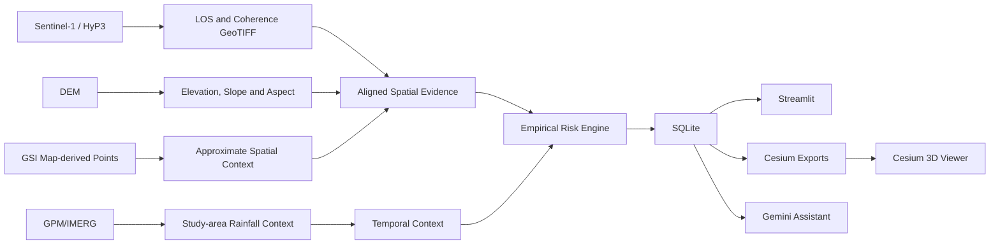
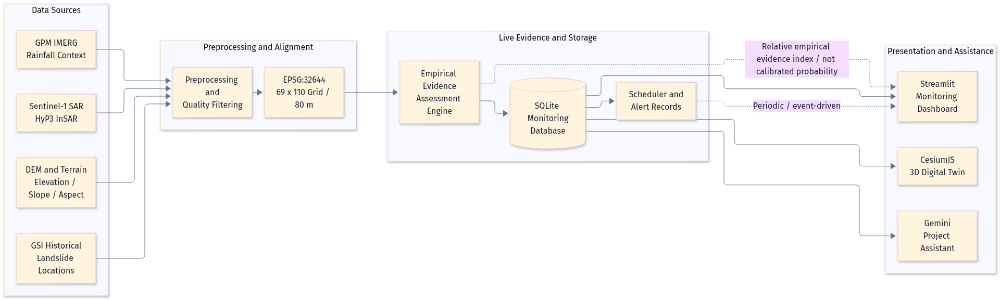
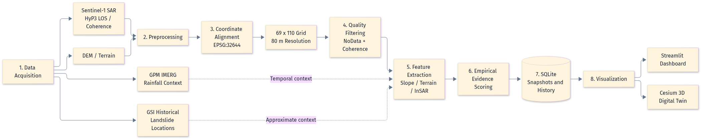
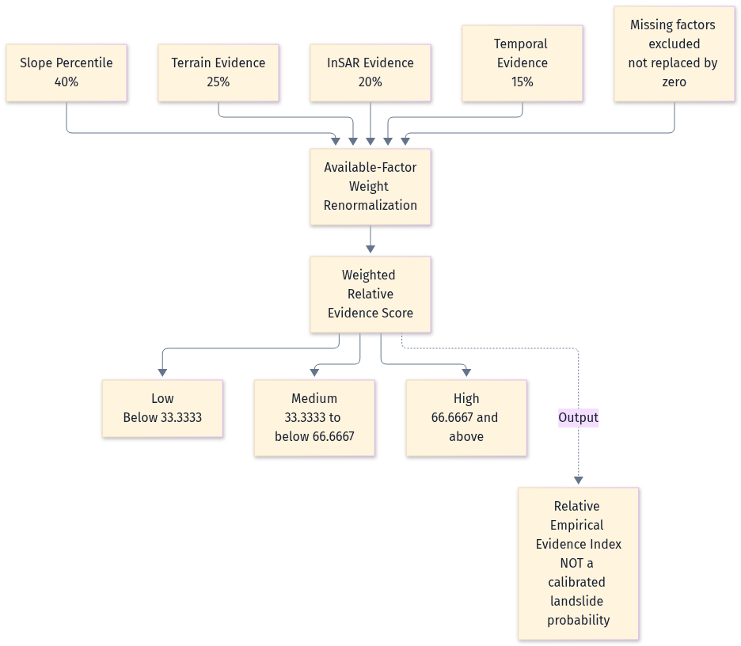
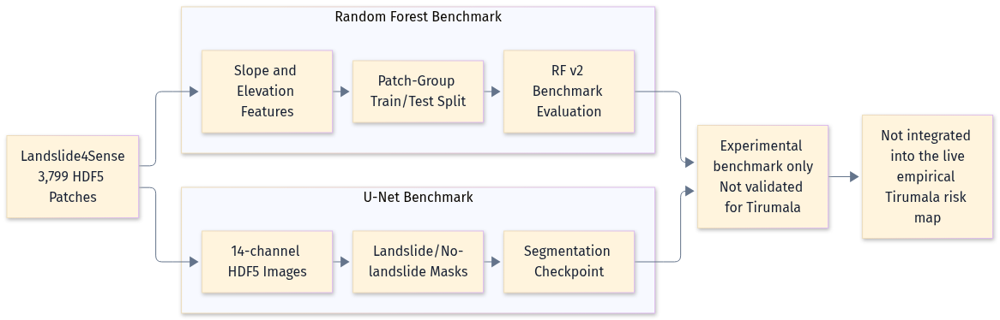
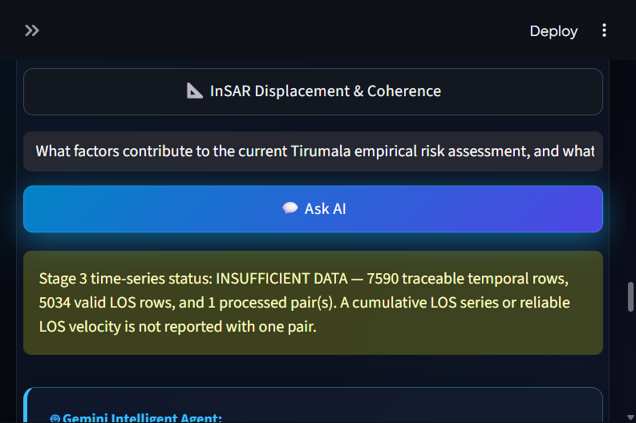
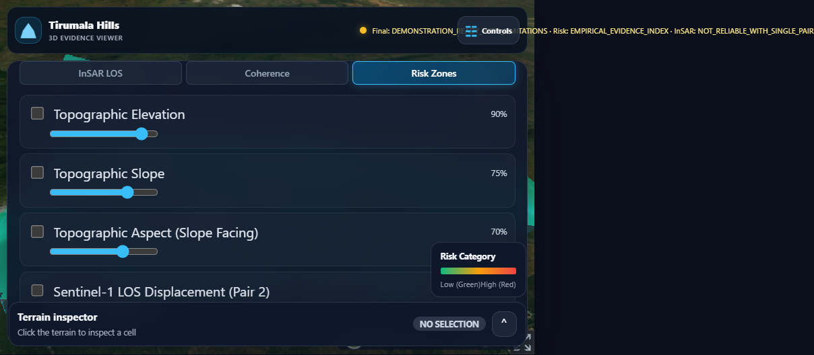

# Landslide Monitoring and Risk Assessment Using Remote Sensing-Enabled Digital Twin and Intelligent Agent

**A Final-Year B.Tech Project Report**

**Study Area:** Tirumala Hills, Tirupati, Andhra Pradesh, India  
**Report Status:** College-ready draft  
**Submitted by:** [STUDENT NAME]  
**Roll Number:** [ROLL NUMBER]  
**Department:** [DEPARTMENT]  
**College:** [COLLEGE NAME]  
**University:** [UNIVERSITY NAME]  
**Guide:** [GUIDE NAME]  
**Academic Year:** [ACADEMIC YEAR]

---

# 1. Title Page

> The complete title page is provided above. Student, college, guide and academic-year fields require confirmation from the student or institution.

# 2. Certificate

**[PLACEHOLDER - not yet signed or approved]**

This is to certify that the project entitled **“Landslide Monitoring and Risk Assessment Using Remote Sensing-Enabled Digital Twin and Intelligent Agent”** submitted by [STUDENT NAME], Roll Number [ROLL NUMBER], is a bonafide work carried out under the guidance of [GUIDE NAME] and the supervision of [DEPARTMENT/COLLEGE] during [ACADEMIC YEAR].

The project report is submitted in partial fulfilment of the requirements for the award of the Bachelor of Technology degree.

**Project Guide:** ____________________  
**Head of Department:** ____________________  
**External Examiner:** ____________________  
**Institution Seal:** ____________________

# 3. Declaration

**[Student declaration template]**

I, [STUDENT NAME], declare that this project report and the accompanying implementation describe work carried out in this project to the best of my knowledge. Data sources, limitations and benchmark experiments are stated rather than presented as validated Tirumala-specific results. I understand that scientific claims in this report must not be interpreted beyond the evidence available in the project.

**Name:** [STUDENT NAME]  
**Signature:** ____________________  
**Date:** ____________________

# 4. Acknowledgement

[EDITABLE TEMPLATE]

I express sincere gratitude to [GUIDE NAME], [DEPARTMENT], [COLLEGE] and [SUPPORTING FACULTY/STAFF] for guidance and encouragement. I acknowledge the use of publicly available and locally supplied geospatial resources, including Sentinel-1 HyP3 products, NASA GPM/IMERG rainfall, Copernicus elevation products, GSI historical map-derived locations and the Landslide4Sense benchmark dataset. Their use is acknowledged for research and demonstration purposes. I also thank project reviewers and peers who provided feedback.

# 5. Abstract

This project presents a research prototype for landslide evidence monitoring and digital-twin visualization in the Tirumala Hills, Tirupati, Andhra Pradesh. It integrates a canonical 69 × 110 spatial grid at 80 m resolution in EPSG:32644, terrain elevation and slope, Sentinel-1 InSAR line-of-sight displacement and coherence, GPM IMERG rainfall context and approximate GSI historical locations.

The implemented Streamlit dashboard applies a transparent relative empirical evidence index using slope percentile (40%), terrain evidence (25%), InSAR evidence (20%) and temporal evidence (15%). Missing factors are excluded and the available weights are renormalized. The resulting Low, Medium and High categories are screening indicators, not calibrated landslide probabilities or confirmed predictions.

The project also includes SQLite history, scheduled monitoring components, alert records, a Gemini assistant grounded in project telemetry and a CesiumJS 3D viewer. Landslide4Sense-based Random Forest and U-Net experiments are preserved as benchmark work but are not validated for Tirumala and do not drive the live risk map. Verification includes SQLite integrity and live application checks, together with 150 passed full-suite tests and 23 passed Phase 7 integration tests. The project is suitable for academic demonstration; operational early-warning or calibrated predictive claims are not supported.

**Keywords:** Landslide monitoring, Tirumala Hills, InSAR, Sentinel-1, remote sensing, digital twin, CesiumJS, Streamlit, empirical risk assessment, Random Forest, U-Net.

# 6. Table of Contents

1. Title Page
2. Certificate
3. Declaration
4. Acknowledgement
5. Abstract
6. Table of Contents
7. List of Figures and Tables
8. Introduction
9. Problem Statement
10. Objectives
11. Existing System and Its Limitations
12. Proposed System
13. System Architecture
14. Technologies and Tools Used
15. Dataset Description and Sources
16. Study Area Description
17. Data Preprocessing and Spatial Grid Generation
18. Methodology
19. InSAR-Based Deformation Monitoring
20. Terrain and Slope Analysis
21. Empirical Risk Assessment
22. Random Forest and U-Net
23. Cesium 3D Digital Twin
24. Streamlit Dashboard
25. Gemini Intelligent Assistant
26. Monitoring Scheduler and Alerts
27. Results and Discussion
28. Testing and Validation
29. Limitations
30. Future Enhancements
31. Conclusion
32. References
33. Appendix

# 7. List of Figures and Tables

## 7.1 Figures

In-report figures use chapter-based numbering. The following figures are embedded because the corresponding PNG files exist:

| Figure | Title | Source |
|---|---|---|
| 23.1 | Verified live Streamlit dashboard overview | `../visual_evidence/01_dashboard_overview.png` |
| 23.2 | Verified live Cesium 3D terrain | `../visual_evidence/07_cesium_3d_terrain.png` |
| 13.1 | System architecture | `../visual_evidence/diagrams/SYSTEM_ARCHITECTURE.png` |
| 18.1 | Data processing workflow | `../visual_evidence/diagrams/DATA_PROCESSING_WORKFLOW.png` |
| 21.1 | Empirical risk assessment workflow | `../visual_evidence/diagrams/EMPIRICAL_RISK_ASSESSMENT.png` |
| 22.1 | AI/ML experimental workflow | `../visual_evidence/diagrams/AI_ML_EXPERIMENTAL_WORKFLOW.png` |

Additional screenshots in `reports/final_submission/visual_evidence/` are available for submission evidence but are not embedded as report figures. Mermaid architecture and workflow files are editable source files only; rendered PNG or SVG versions have not been created.

## 7.2 Tables

| Table | Title |
|---|---|
| Table | Title |
|---|---|
| 16.1 | Tirumala canonical spatial-grid information |
| 21.1 | Empirical risk categories |
| 22.1 | Random Forest benchmark evaluation metrics |
| 27.1 | Verified project results |
| 28.1 | Testing and validation summary |
| 33.1 | Implemented, partial and future feature status |

# 8. Introduction

Landslide risk assessment is important in mountainous, populated and climatically variable regions. Tirumala Hills is a major pilgrimage and tourism area with ghat-road environments, terrain variation and available remote-sensing data. These characteristics make it suitable for a geospatial monitoring prototype, but they do not by themselves establish a validated landslide prediction system.

A digital-twin concept is used here to combine terrain observations, Sentinel-1 InSAR evidence, rainfall context and approximate historical locations within an interactive geospatial interface. The implementation supports evidence viewing, rule-based screening and human review rather than automatic landslide prediction. It preserves a distinction among measured or derived data, relative risk scoring, historical context and benchmark machine-learning experiments.

# 9. Problem Statement

Landslide-related information is commonly distributed across terrain rasters, radar products, rainfall records, historical maps and separate application interfaces. Without explicit alignment and quality controls, multiple sources may be interpreted inconsistently or presented with greater certainty than the underlying evidence supports.

The project addresses this problem by creating a common 80 m spatial reference, separating available and unavailable evidence, documenting pair-specific InSAR limitations and presenting a weighted screening index that is not calibrated as probability. The implementation also distinguishes approximate GSI locations, aggregate rainfall context and external benchmark models from verified Tirumala ground truth.

The resulting system is therefore an evidence-oriented decision-support prototype. It is not an operational early-warning system and does not establish local predictive accuracy.

# 10. Objectives

1. Establish a canonical 69 × 110 Tirumala spatial grid in EPSG:32644.
2. Integrate DEM, slope, aspect and quality-controlled InSAR LOS/coherence rasters.
3. Preserve rainfall and GSI data as contextual information with explicit limitations.
4. Implement a transparent relative empirical risk index.
5. Store observations, risk history and alerts in SQLite.
6. Implement CesiumJS 3D visualization and Streamlit dashboard presentation.
7. Document benchmark Random Forest and U-Net experiments without local validation claims.
8. Implement alerting and Gemini assistant components with evidence-aware disclaimers.
9. Perform automated tests and live browser verification.
10. Produce an academically honest report and preserve the existing production risk behavior.

## 10.1 Scope

The implemented scope is restricted to spatial evidence integration, transparent risk scoring, monitoring and visualization. Future work includes locally validated modeling, rainfall raster reconciliation, additional InSAR acquisitions and verified notification delivery. These items are proposed enhancements and are not represented as current implementation achievements.

# 11. Existing System and Its Limitations

Before this project, landslide-related information could exist as separate reports, raster files and datasets. Such information may lack:

- a common study-area coordinate system;
- NoData/quality handling;
- temporal continuity;
- verified positive and negative local ground truth;
- traceable database history;
- an interactive geospatial interface;
- clear separation between empirical evidence and model probability.

In particular, conventional image or model outputs can appear more certain than they are. This project avoids such presentation by clearly marking empirical and benchmark outputs.

# 12. Proposed System

The proposed system is a multi-tier research prototype:

```text
Sentinel-1 and HyP3 products
        |
        v
Preprocessing and quality validation
        |
        v
EPSG:32644 80 m aligned feature grids
        |
        +--> Terrain and InSAR observations
        +--> Temporal context
        +--> GSI and rainfall context
        |
        v
Empirical evidence index
        |
        +--> SQLite observation snapshots and history
        +--> Alert generation and audit
        +--> Streamlit dashboard
        +--> Cesium 3D digital-twin viewer
        +--> Gemini evidence-grounded assistant
```

The system does not train or integrate a local Random Forest or U-Net prediction as part of the live risk calculation.

# 13. System Architecture

## 13.1 Architecture tiers

| Tier | Implemented responsibility |
|---|---|
| Data sources | Sentinel-1/InSAR, DEM/terrain, GPM/IMERG rainfall, GSI map-derived locations |
| Processing | Raster alignment, quality masking, feature extraction, temporal metadata |
| Evidence engine | Empirical factor calculation and category assignment |
| Storage | SQLite monitoring database |
| Presentation | Streamlit dashboard and CesiumJS viewer |
| Assistance | Gemini assistant grounded in database telemetry |
| Automation | APScheduler and pipeline logging |

## 13.2 Component relationship



## 13.3 Database relationship

The database stores acquisitions, InSAR pairs, rainfall records, spatial evidence, temporal observations, observation snapshots, risk history, alerts and pipeline logs. The live empirical map uses stored spatial evidence and the existing risk implementation.



*Figure 13.1: Overall system architecture.*

# 14. Technologies and Tools Used

| Area | Technology |
|---|---|
| Programming | Python 3 |
| Dashboard | Streamlit |
| Database | SQLite |
| Geospatial data | rasterio, pyproj, pandas, NumPy |
| InSAR processing source | ASF HyP3 GAMMA products |
| Machine learning | scikit-learn |
| Deep learning demonstration | PyTorch, h5py |
| 3D visualization | CesiumJS, WebGL |
| 2D mapping | Leaflet/Folium components |
| Scheduling | APScheduler |
| Testing | pytest |
| Intelligent assistant | Google Gemini SDK/API |
| Packaging/export | SQLite, GeoJSON, PNG, GLB |

Version numbers must be recorded from the actual environment before formal publication. The verified test environment uses Python 3.13 and scikit-learn 1.7.2 for loading/evaluating the RF artifact.

# 15. Dataset Description and Sources

## 15.1 Tirumala project data

| Dataset | Source/status | Use |
|---|---|---|
| DEM | SRTM/Copernicus processed 80 m raster | Elevation and terrain |
| Slope | Derived from DEM | Empirical terrain evidence |
| Aspect | Derived from DEM | Terrain description |
| Sentinel-1 InSAR LOS | ASF HyP3 | Relative LOS evidence |
| InSAR coherence | ASF HyP3 | Quality filtering |
| GPM/IMERG rainfall | NASA GPM temporal records | Temporal context only |
| GSI locations | Map-derived approximate points | Historical spatial context |
| Landslide4Sense HDF5 | External benchmark dataset | RF/U-Net experiments |

## 15.2 Landslide4Sense benchmark

- 3,799 HDF5 image/mask pairs.
- Image shape: 128 × 128 × 14.
- Mask shape: 128 × 128.
- These patches are external benchmark data.
- Their geographic coordinates and CRS are not established for Tirumala mapping.

## 15.3 Random Forest benchmark data

The RF v3 CSV has 190,644 rows and 3,799 patch IDs. It contains the `slope`, `elevation` and `label` fields plus patch ID. The v3 data includes 12,388 exact duplicate rows and is not a Tirumala ground-truth table.

# 16. Study Area Description

The study area is Tirumala Hills near Tirupati, Andhra Pradesh, India. The canonical grid is defined in EPSG:32644 with 69 rows and 110 columns.

**Table 16.1 – Tirumala canonical spatial-grid information**

| Property | Value |
|---|---:|
| Grid rows | 69 |
| Grid columns | 110 |
| Grid cells | 7,590 |
| Resolution | 80 m |
| DEM valid cells | 4,083 |
| Slope valid cells | 3,692 |
| Aspect valid cells | 4,083 |
| November InSAR quality-valid intersection | 5,034 |
| Approximate GSI locations | 15 |
| Rainfall records | 29 aggregate records |

Coordinates and elevation values are projected or transformed consistently for this implementation. Approximate GSI points are not surveyed ground truth.

# 17. Data Preprocessing and Spatial Grid Generation

## 17.1 Raster alignment

The canonical rasters use EPSG:32644 and an 80 m grid. The live November LOS and coherence rasters have 69 × 110 dimensions and common 80 m bounds. Source rasters were not overwritten.

## 17.2 Terrain processing

Elevation is obtained from the processed DEM. Slope and aspect are derived raster products. NoData and invalid DEM/slope/aspect values remain unavailable rather than being replaced with a false value.

## 17.3 InSAR processing

The November pair uses reference date 2026-11-09 and secondary date 2026-11-21. The baseline is 12 days. The HyP3 job is `3889d809-88a3-4a93-89a5-258821932737`.

The coherence threshold used by the project is 0.50. The quality-valid intersection of LOS and coherence contains 5,034 cells.

## 17.4 Rainfall preprocessing

Rainfall has 29 study-area aggregate records. The Stage 6 rainfall audit found stored rollups disagreeing with independent recalculation for multiple 3-day, 7-day and 14-day windows and recorded 27 records as requiring reconciliation. These records are aggregate study-area context; they do not form a 69 × 110 rainfall raster and are not used as pixel predictors in the canonical empirical formula.

## 17.5 Missing values

Missing and low-quality values are preserved and excluded from the applicable factors. The system does not convert NoData or low coherence to zero movement.

# 18. Methodology

## 18.1 Acquisition and preprocessing

The implemented workflow begins with locally available Sentinel-1, HyP3 InSAR, DEM, rainfall and GSI source records. Sentinel-1 SAR/InSAR products provide pair-specific LOS displacement and coherence. DEM-derived elevation, slope and aspect describe terrain. GPM IMERG values provide study-area temporal rainfall context, while GSI locations provide approximate historical spatial context.

## 18.2 Spatial alignment and integration

The canonical grid is defined in EPSG:32644 at 80 m resolution. The LOS and coherence rasters are aligned to the 69 × 110 matrix. Raster NoData values and low-quality coherence observations remain unavailable for the applicable analysis rather than being replaced with a false numerical value.

## 18.3 Evidence assessment

The current dashboard calculates an evidence score using four factors. Missing factors are excluded and remaining weights are renormalized. The resulting category is Low, Medium or High.

## 18.4 Storage and presentation

Spatial observations, risk history and alerts are stored in SQLite. The backend exports manifest, lookup and visualization assets for Cesium, while Streamlit displays the same empirical evidence through tables, charts and interactive tabs.

No physical landslide prediction or calibrated probability is produced. The scheduled pipeline and external download components operate periodically or by event and should not be described as continuous second-by-second monitoring.



*Figure 18.1: Data acquisition and processing workflow.*

# 19. InSAR-Based Deformation Monitoring

## 19.1 LOS displacement

The verified November 2026 LOS raster is relative line-of-sight displacement in metres. Valid finite observations range approximately from -0.111919 m to -0.053715 m.

LOS is not vertical displacement. LOS values do not establish actual three-dimensional ground movement without additional viewing geometry and ascending/descending observations.

## 19.2 Coherence

The coherence raster supports quality screening. Coherence at or above 0.50 passes the project quality rule. Lower coherence is not evidence of zero displacement.

## 19.3 Temporal reliability

Only one November pair is presently quality-validated. One quality-valid edge is insufficient for reliable cumulative displacement or velocity inversion. Cumulative displacement and deformation velocity are explicitly unavailable.

# 20. Terrain and Slope Analysis

The terrain layer includes DEM elevation, Horn's slope and aspect. Elevation and slope contribute to the empirical evidence framework. Slope is ranked within the current study-area observations rather than mapped to a universal landslide probability threshold.

Terrain validity depends on raster NoData. DEM valid cells are 4,083 and slope valid cells are 3,692.

# 21. Empirical Risk Assessment

The empirical score is:

```text
Risk = renormalized weighted sum of:
  Slope percentile       40%
  Terrain evidence       25%
  InSAR evidence         20%
  Temporal evidence      15%
```

## 21.1 Classification

**Table 21.1 – Empirical risk categories**

| Category | Score range |
|---|---|
| Low | Below 33.3333 |
| Medium | 33.3333 to below 66.6667 |
| High | 66.6667 and above |

Missing factors are excluded rather than set to zero. Available weights are renormalized. Rainfall is deliberately excluded from the per-cell formula.

## 21.2 Scientific interpretation

The output is a relative evidence index. It is not calibrated, is not a confirmed probability and cannot serve as a standalone operational landslide warning.



*Figure 21.1: Implemented empirical risk assessment workflow.*

# 22. Random Forest and U-Net: Experimental/Baseline Work and Limitations

## 22.1 Random Forest

A patch-level RF v2 classifier was trained on Landslide4Sense-derived pixels using slope and elevation. The RF v3 dataset has 190,644 rows, 3,799 unique patch IDs and 12,388 exact duplicate rows. The saved v2 artifact was evaluated against the declared patch-grouped v3 test split without retraining. The reproduction used 151,706 training samples from 3,039 patches and 38,938 test samples from 760 patches, with no patch-ID overlap.

**Table 22.1 – Random Forest benchmark evaluation metrics**

| Metric | Reproduced value |
|---|---:|
| Accuracy | 0.5626637 |
| Balanced accuracy | 0.5623652 |
| Precision | 0.5575985 |
| Recall | 0.5423923 |
| F1 | 0.5498903 |

A 100-tree Moghalrajpuram model exists as a separate artifact. Its training dataset and metrics are unknown. Neither RF is a source of the current Tirumala dashboard map.

## 22.2 U-Net

A 14-channel Landslide4Sense U-Net checkpoint exists for benchmark segmentation. Channels 12 and 13 correspond to slope and elevation in the existing extraction workflow. It is not georeferenced or locally validated for Tirumala.

## 22.3 Model limitations

- No independent Tirumala labels.
- External benchmark geography.
- Unknown RF patch CRS.
- 12,388 duplicate rows in RF v3.
- Moderate reproduced benchmark performance.
- No spatially blocked Tirumala validation.
- No calibrated local probability.
- No live RF/U-Net output in the dashboard risk calculation.



*Figure 22.1: Separate Random Forest and U-Net benchmark workflows.*

# 23. 3D Digital Twin Implementation Using Cesium

The Cesium 3D viewer is a local static web application at `http://127.0.0.1:8088`. It provides:

- elevation, slope, aspect, LOS, coherence and risk-zone layers;
- three InSAR epochs;
- 15 historical GSI points;
- GSI AOI boundary;
- camera presets;
- terrain inspector UI;
- layer opacity and visibility controls;
- a 360-degree drone-tour control.

Six evidence layers and three InSAR epochs are declared in the Cesium manifest. Browser verification returned HTTP 200 asset responses and the Cesium camera/layer controls responded. The terrain inspector raycast was not fully automated in browser testing.

The existing dashboard screenshot and Cesium screenshot are shown below.



*Figure 23.1: Verified live Streamlit dashboard overview.*



*Figure 23.2: Verified live Cesium 3D terrain and navigation interface.*

Additional verified screenshots for risk assessment, monitoring, automation, alerts, Gemini and Cesium layers are indexed in `reports/final_submission/visual_evidence/VISUAL_EVIDENCE_INDEX.md`.

# 24. Streamlit Dashboard Implementation

The canonical dashboard is `dashboard/app.py`. It includes:

1. Overview.
2. 3D Digital Twin.
3. Continuous monitoring.
4. Risk assessment.
5. Automation status.
6. Alerts and reports.

Live browser verification found all tabs loading and the main controls responding. Streamlit is available at `http://127.0.0.1:8501`.

The Streamlit UI uses the empirical evidence index and clearly describes it as not calibrated. It does not present the benchmark RF or U-Net as Tirumala-validated predictions.

# 25. Gemini-Based Intelligent Assistant

The Gemini assistant is grounded in project telemetry and documentation. A browser query explaining the empirical risk factors and limitations returned a relevant response that did not expose API credentials or invent predictions.

API connectivity and browser response passed. The assistant should remain framed as supporting interpretation; it does not independently validate evidence or issue official alerts.

# 26. Monitoring Scheduler and Alert Management

The project includes APScheduler configuration and pipeline logs for satellite discovery, rainfall checks and master-pipeline triggers. The live scheduler process was running and the browser displayed the next scheduled pipeline and completed pipeline status.

The alert engine stores 33 historical alert records in the database. Alert categories include critical, warning and advisory records. No notification delivery has been confirmed.

Telegram and SMTP credentials are not configured or externally verified. No test messages were sent.

# 27. Results and Discussion

The project successfully demonstrates:

- a canonical 80 m aligned Tirumala grid;
- a quality-controlled November InSAR product;
- empirical risk visualization;
- SQLite historical storage;
- 3D and 2D interface integration;
- Gemini assistant integration;
- alert history and scheduler status;
- live browser access and asset synchronization.

Key metrics include:

**Table 27.1 – Verified project results**

| Item | Verified result |
|---|---:|
| Grid | 7,590 cells |
| DEM valid | 4,083 |
| Slope valid | 3,692 |
| Aspect valid | 4,083 |
| InSAR quality-valid | 5,034 |
| Observation snapshots | 45,554 |
| Risk history | 2 |
| Alerts | 33 |
| HDF5 patches | 3,799 |
| RF v3 duplicate rows | 12,388 |

The project should be discussed as a research/demonstration system. It does not establish local predictive accuracy.

# 28. Testing and Validation

## 28.1 Database validation

SQLite integrity check: `ok`.

Important counts at final verification:

- observation_snapshots: 45,554;
- risk_history: 2;
- alerts: 33;
- pipeline_logs: 144;
- acquisitions: 20;
- InSAR pairs: 3;
- temporal observations: 7,590;
- rainfall records: 29;
- notification deliveries: 0.

## 28.2 Test suite

**Table 28.1 – Testing and validation summary**

| Test category | Result |
|---|---|
| Phase 7 relevant tests | 23 passed, 8 warnings |
| Full suite | 150 passed, 12 warnings, 6 subtests passed |
| SQLite integrity | Passed |
| Cesium manifest HTTP probe | 200 |
| Streamlit browser | PASS WITH LIMITATIONS |
| Cesium browser | PASS WITH LIMITATIONS |
| Gemini browser/API | PASS |

## 28.3 Browser verification

All six Streamlit tabs loaded. Six Cesium evidence layers and three InSAR epochs were available. Some automated raycast and Reset View interactions remained limited by overlay geometry and therefore are not fully automated.

# 29. Limitations

1. Independent Tirumala ground-truth labels are insufficient for supervised local training.
2. RF benchmark metrics are not local Tirumala performance.
3. The U-Net is benchmark-derived and not locally validated.
4. The empirical risk index is not calibrated probability.
5. Only one November InSAR pair is quality-validated for the stated temporal analysis.
6. Cumulative LOS displacement and velocity are not established.
7. Pair-specific phase references prevent scientifically established cross-pair subtraction.
8. Rainfall rollups have unresolved inconsistencies and rainfall is not pixel-level per-cell data.
9. GSI locations are approximate map-derived points.
10. Telegram/SMTP alert delivery is unverified.
11. Repeated automated monitoring cycles have not been fully demonstrated.
12. Monitoring is periodic/event-driven, not second-by-second continuous monitoring.
13. The UI should not be presented as an operational early-warning authority.

# 30. Future Enhancements

1. Add more quality-controlled Sentinel-1 acquisitions and real temporal networks.
2. Establish cumulative displacement and velocity only after a valid network is available.
3. Reconcile rainfall data and validate pixel-level rainfall rasters.
4. Collect independent, georeferenced and field-verified Tirumala landslide labels.
5. Train and independently evaluate Tirumala-specific RF or other supervised models.
6. Add calibration, uncertainty and spatially blocked cross-validation.
7. Improve alert delivery through verified Telegram/SMTP gateways.
8. Improve scheduler reliability and alert retry telemetry.
9. Improve Cesium raycast, inspector and camera-obstruction behavior.
10. Extend Sentinel-2/land-cover features only from complete and usable products.
11. Add field-survey and GSI polygon integration.
12. Implement formal local model governance and monitoring drift checks.

# 31. Conclusion

The project implements a technically traceable Tirumala landslide monitoring research prototype. It integrates terrain, InSAR, rainfall context, historical location evidence, SQLite storage, Cesium visualization, Streamlit interaction and Gemini-assisted explanation. It also contains benchmark RF and U-Net artifacts, but these are not presented as validated Tirumala predictions.

The 3D digital twin, dashboard and Gemini assistant were verified live. The empirical risk index is transparent and limited, and existing testing passed. The project is ready for academic submission with explicit limitations, but it is not ready for scientifically defensible local supervised model training or operational landslide-warning claims.

# 32. References

The final report should use the citation style prescribed by the institution. References below are limited to sources identified in the project repository or official software documentation. Publication details, authors and edition information should be completed only after verification.

[1] ASF. *HyP3 InSAR Processing Documentation.* https://hyp3-docs.asf.alaska.edu/ (access details require institution-prescribed verification).

[2] NASA. *Global Precipitation Measurement Mission: IMERG Data.* https://gpm.nasa.gov/data/imerg

[3] European Union/Copernicus. *Copernicus Digital Elevation Model.* https://spacedata.copernicus.eu/collections/copernicus-digital-elevation-model

[4] Landslide4Sense. *Landslide4Sense benchmark dataset and repository.* https://github.com/iarai/Landslide4Sense

[5] Streamlit. *Streamlit documentation.* https://docs.streamlit.io/

[6] Cesium. *CesiumJS documentation and API reference.* https://cesium.com/learn/cesiumjs-learn/

[7] Scikit-learn developers. *RandomForestClassifier documentation.* https://scikit-learn.org/

[8] PyTorch contributors. *PyTorch documentation.* https://pytorch.org/docs/

**References requiring manual verification:** Geological Survey of India map/report information, historical Tirumala landslide records, COOLR/NASA source metadata and any exact publication citation. Author names, report numbers, publication years and page numbers must not be inferred.

No GSI or COOLR entry is presented as a complete bibliographic citation until the original source title, authoring organization and publication metadata are verified.

# 33. Appendix

## Appendix A: Feature Status Matrix

**Table 33.1 – Implemented, partial and future feature status**

| Feature | Status |
|---|---|
| DEM/terrain | Implemented and verified |
| Slope/aspect | Implemented and verified |
| InSAR LOS/coherence | Implemented with one quality-valid pair limitation |
| Empirical risk formula | Implemented and tested |
| SQLite storage | Implemented and integrity verified |
| Cesium 3D viewer | Implemented and live verified |
| Streamlit dashboard | Implemented and live verified |
| Gemini assistant | Implemented and live tested |
| Scheduler | Implemented and running with external limitations |
| Alerts | Implemented and records verified |
| External notification delivery | Partial/not configured |
| Local RF training | Not implemented/benchmarked only |
| Local U-Net validation | Not implemented |
| Pixel-level rainfall | Not implemented |
| Independent ground truth | Insufficient |

## Appendix B: Verified test commands

```text
python -m pytest -q
python -m pytest -q tests/test_risk_engine.py tests/test_backend_integration.py tests/test_emergency_final_integration.py
python -m streamlit run dashboard/app.py --server.address 127.0.0.1 --server.port 8501 --browser.gatherUsageStats false
python scripts/serve_3d_viewer.py --open-browser
```

## Appendix C: Project evidence documents

- `PHASE7_CHECKPOINT1_RANDOM_FOREST_AND_RISK_AUDIT.md`
- `reports/phase7_checkpoint2/PHASE7_CHECKPOINT2_SPATIAL_FEATURE_AND_GROUND_TRUTH_READINESS.md`
- `reports/final_submission/FINAL_PROJECT_HEALTH_AUDIT.md`
- `reports/final_submission/TASK2_LIVE_APPLICATION_VERIFICATION.md`
- `reports/final_submission/TASK3_END_TO_END_FUNCTIONAL_TEST_REPORT.md`
- `MASTER_PHASE6_INSAR_TEMPORAL_CHANGE_ANALYSIS_REPORT.md`
- `TECHNOLOGY_ARCHITECTURE.md`

